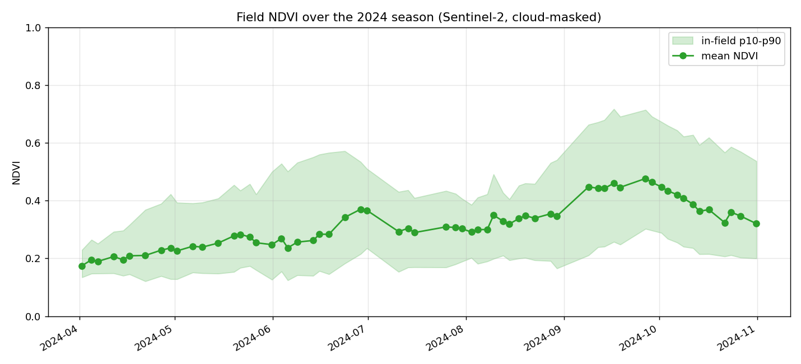
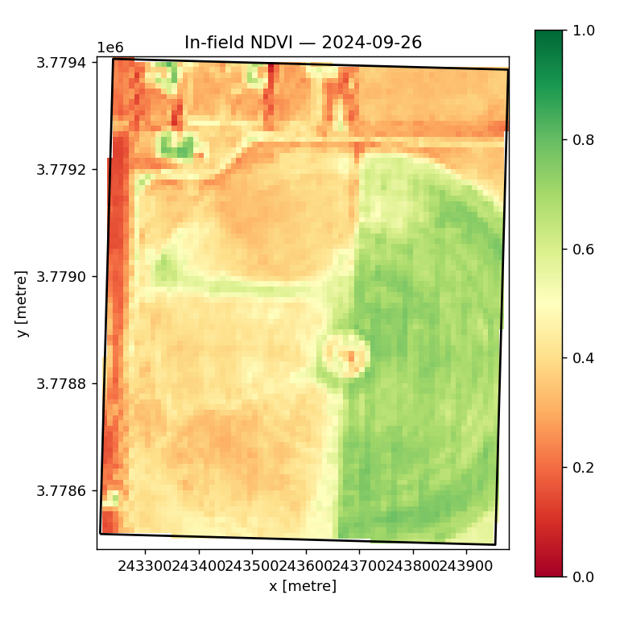

# Agrismart 2.0

> A web platform where a farmer draws their field on a map and gets satellite-based crop health
> monitoring, data-backed crop recommendations, yield forecasts, disease diagnosis from a leaf
> photo, and an AI advisor that answers questions using their own field's data.

Agrismart 2.0 is a ground-up rebuild of the original Agrismart (a PyTorch + Flask crop-prediction
app) into a real production system: live satellite imagery, honest ML evaluation, event-driven
pipelines, and an AWS cloud deployment.

See [`agrismart-2.0-build-plan.md`](agrismart-2.0-build-plan.md) for the full vision, architecture,
and 16-week roadmap.

## Status

**Phase 0 — de-risking.** Proving the single hardest technical risk before investing in
infrastructure: can we pull free Sentinel-2 satellite imagery for an arbitrary field and compute a
useful crop-health (NDVI) time series?

| Phase | What | State |
|---|---|---|
| **De-risk** | Satellite NDVI notebook over a Texas field (Earth Search STAC) | **In progress** |
| 0 | AWS hygiene, budget alarms, Terraform skeleton, CI | Not started |
| 1 | Field management (auth, draw fields, PostGIS) + crop recommendation v1 | Not started |
| 2 | Satellite health pipeline + backfill | Not started |
| 3 | Crop-type classifier + yield forecaster | Not started |
| 4 | Event-driven alerts | Not started |
| 5 | Disease CV + AI advisor (RAG + agent) | Not started |
| 6 | Hardening + real users | Not started |

## Repository layout

```
apps/        web (React + MapLibre) and api (FastAPI)
pipelines/   ingest (STAC), weather, soil, alerts
ml/          recommend, croptype, yield, disease, common
advisor/     RAG, agent tools, evals
infra/       Terraform (all AWS as code)
notebooks/   exploration / de-risking work
docs/        architecture, model cards, DATA_SOURCES.md
tests/       unit, integration, e2e
```

## The de-risk notebook

[`notebooks/01_field_ndvi_timeseries.ipynb`](notebooks/01_field_ndvi_timeseries.ipynb) does the
single biggest de-risking step from the plan (Section 14):

1. Define a Texas field polygon.
2. Search the free [Earth Search STAC API](https://earth-search.aws.element84.com/v1) for
   Sentinel-2 L2A scenes over it.
3. Read only the pixels inside the field (windowed COG reads).
4. Mask clouds/shadows with the scene-classification (SCL) band.
5. Compute NDVI and plot a season-long time series + a map.

### Run it

```bash
python3.11 -m venv .venv
source .venv/bin/activate
pip install -r requirements-notebook.txt
jupyter lab notebooks/01_field_ndvi_timeseries.ipynb
```

No AWS account or credentials are required — Earth Search Sentinel-2 data is free and read
anonymously.

### Result

Running it over a ~65 ha field near Plainview, TX pulled **62 cloud-masked Sentinel-2 scenes**
across the 2024 season and produced a textbook crop-phenology curve — bare ground in April,
canopy build-up through summer, peak greenness in late September, senescence toward harvest:





This proves the hardest technical risk (satellite data at scale) end-to-end on free, public data.

## Data sources

All data used is free. License and attribution notes live in
[`docs/DATA_SOURCES.md`](docs/DATA_SOURCES.md).

## License

MIT — see [`LICENSE`](LICENSE).
