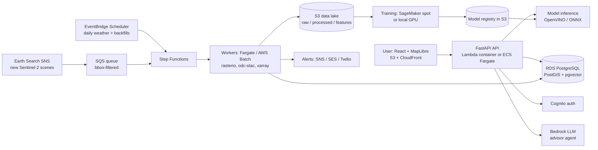

# Agrismart 2.0: Rebuild and Upgrade Plan

> **One-line pitch:** A web platform where a farmer draws their field on a map and gets satellite-based crop health monitoring, data-backed crop recommendations, yield forecasts, disease diagnosis from a leaf photo, and an AI advisor that answers questions using their own field's data.

---

## 1. Why Rebuild (and What Changes)

**Original Agrismart (Oct 2024 – Apr 2026):** a PyTorch + Flask web app that predicted the best crop to plant from rainfall, soil aridity, and temperature, trained on 20+ years of agricultural data across 10,000+ location records.

**The problem:** the original files are gone. The original was also a single model behind a web form: one prediction, no live data, no cloud deployment, no monitoring.

**Agrismart 2.0** keeps the same mission and core skills, but turns it into a real production system:

| | Original | 2.0 |
|---|---|---|
| Data | Static historical dataset | Live satellite imagery + weather + soil + USDA crop history |
| ML | One crop-prediction model | Crop recommendation, crop-type classification, yield forecasting, field-health anomaly detection, leaf disease CV |
| AI | None | RAG + tool-calling advisor grounded in the user's own field data |
| Backend | Flask, run locally | FastAPI on AWS, event-driven pipelines, Postgres + PostGIS |
| Ops | None | Terraform, CI/CD, monitoring, cost controls, tests |
| Users | Claimed | Measured: real fields, real alerts, real usage metrics |

### Against my four requirements
1. **Shared skills (replacement):** PyTorch, Pandas, scikit-learn, Python web backend, weather/soil feature engineering, multi-year historical data. Same domain and same name.
2. **New skills:** AWS (S3, Lambda/ECS, RDS, Step Functions, SQS/SNS, Bedrock, Cognito, CloudFront), Terraform, CI/CD, geospatial data (PostGIS, raster processing, STAC), time-series deep learning, LLM agents with evals, event-driven architecture.
3. **Hard:** geospatial pipelines, satellite data at scale, honest ML evaluation (spatial and temporal holdouts), event-driven ingestion, an agent with tool use and evals.
4. **Usable:** Texas A&M is one of the country's top agriculture schools. AgriLife Extension, ag student orgs, and family farms are realistic pilot users. The satellite data is free and covers every field on Earth, so it works for any user from day one.

---

## 2. Users and Core Use Cases

**Primary user:** a small or mid-size farmer or ag student in Texas (start there, expand later).

1. **"What should I plant here?"** Draw a field → get ranked crop suggestions based on that location's soil, climate history, and what has historically grown successfully nearby.
2. **"Is my field healthy?"** See a satellite health map (NDVI) of the field over the season, compared to the field's own past years and to similar fields nearby.
3. **"Something's wrong. Tell me early."** Get an alert (email/SMS) when part of a field drops below its expected health, or when frost or drought is forecast.
4. **"What will I harvest?"** Get a yield estimate that updates as the season progresses.
5. **"What's on this leaf?"** Upload a photo → get a likely disease plus confidence and next steps.
6. **"Ask anything."** Chat with an advisor that can look up the field's data and cite extension publications in its answers.

---

## 3. Feature Modules

Build these in order. Each one is useful on its own.

### Module A: Field Management (foundation)
- Draw or upload field boundaries on a map (MapLibre GL + drawing plugin, or upload a GeoJSON/KML).
- Store as PostGIS polygons; compute area, centroid, county.
- User accounts via Cognito; each user sees only their own fields (multi-tenant authorization tested).
- **Done when:** a user can sign up, draw three fields, and see them on a map after logging back in.

### Module B: Crop Recommendation v2 (the rebuilt original)
The original likely relied on a simple tabular dataset. v2 trains on **real observed outcomes**:
- **Labels:** USDA Cropland Data Layer (CDL) gives the crop actually grown on every 30m pixel in the US each year. Successful, repeated crops in a location are positive signals.
- **Features:** soil properties (SSURGO / SoilGrids: texture, pH, organic matter, drainage), 20+ years of climate (NASA POWER / Open-Meteo: rainfall, growing degree days, heat days, frost dates), elevation/slope (Copernicus DEM), and county yields (USDA NASS).
- **Model:** gradient boosting baseline (XGBoost/LightGBM) → PyTorch tabular model. Output is ranked crop suitability with explanations (SHAP: "recommended because of high soil water capacity and 240 frost-free days").
- **Evaluation:** **spatial holdout** (train on some counties, test on others) so the model isn't graded on places it memorized. Report top-3 accuracy and calibration, not just accuracy.
- **Done when:** recommendations for a new field return in under a second with an explanation, and the eval report is in the repo.

### Module C: Satellite Health Monitoring (the big upgrade)
- **Data:** Sentinel-2 Level-2A imagery (10m resolution, a new image roughly every 5 days), free on AWS as Cloud-Optimized GeoTIFFs and searchable through Element 84's **Earth Search STAC API** (`https://earth-search.aws.element84.com/v1`, collection `sentinel-2-c1-l2a`). The data lives in AWS **us-west-2**, so deploy there to avoid transfer costs.
- **Pipeline per field:** query STAC for new scenes → read only the pixels inside the field (COGs allow partial reads) → mask clouds and shadows using the scene classification (SCL) band → compute indices (NDVI, EVI, NDWI) → store per-field statistics (mean, percentiles) plus a small rendered map tile.
- **Backfill:** 2017 → present for every field, so each field has its own history.
- **Health score:** compare today's NDVI to (a) the same field at the same point in past seasons and (b) neighboring fields growing the same crop (via CDL). Flag zones that fall below expectation.
- **Done when:** any field shows a season-long NDVI chart and map, cloudy scenes are filtered out correctly, and a 50-field backfill finishes reliably without manual babysitting.

### Module D: Crop-Type Classification and Yield Forecasting (core ML depth)
- **Crop-type classifier:** given a field's satellite time series for a season, predict what crop is growing. Labels come from CDL. Baseline: LightGBM on monthly composites. Main model: a PyTorch temporal model (LSTM or small Transformer over the time series). This automatically fills in a field's crop if the user didn't specify it.
- **Yield forecaster:** predict county-level yield (USDA NASS labels) from in-season satellite plus weather features, updated as the season progresses. Then explore downscaling to individual fields.
- **Evaluation rules:**
  - Temporal holdout: train on past years, test on a later year (**leave-one-year-out**). No random splits, because random splits leak time.
  - Spatial holdout for the classifier.
  - Always compare against a dumb baseline (last year's yield, 5-year trend) and report improvement over it.
  - Show how accuracy improves as the season progresses (early-season vs late-season forecasts).
- **Done when:** an evaluation notebook and a written model card report honest metrics against baselines.

### Module E: Event-Driven Alerts
- **Event-driven ingestion:** Earth Search publishes an AWS SNS notification whenever a new scene is cataloged. Subscribe an SQS queue (filtered to your region's bounding box) so new imagery is processed automatically as it arrives. No polling needed.
- **Weather alerts:** daily scheduled job (EventBridge Scheduler) pulls forecasts and checks each field for frost, heat, or heavy rain thresholds.
- **Anomaly alerts:** when Module C's health score drops sharply, notify the user.
- **Delivery:** email first (SES/SNS), SMS later (Twilio). Weekly digest per user.
- **Reliability:** idempotent processing (the same scene must never create two alerts), dead-letter queues, retries.
- **Done when:** a new satellite pass over a test field triggers processing and, if warranted, an alert, with no manual action.

### Module F: Leaf Disease Diagnosis (CV + Intel tie-in)
- Train a CNN/ViT classifier (transfer learning) on **PlantVillage + PlantDoc**.
- **The important part is honest evaluation.** PlantVillage photos are lab images (single leaf, plain background), and models that score ~99% on them collapse on real field photos. Published cross-dataset tests show F1 falling to roughly 13% on PlantDoc. Train on mixed lab and field data, evaluate on **held-out field images**, and report the cross-dataset gap. That analysis is more impressive than a high accuracy number.
- Add an "I'm not sure" threshold, so low-confidence predictions say so instead of guessing.
- Export to **ONNX → OpenVINO** for fast CPU inference, which directly reuses your Intel and research-assistant experience.
- **Done when:** photo upload returns a diagnosis in under 1 second with a confidence score, and the cross-dataset results are documented.

### Module G: AI Farm Advisor (agent + RAG + evals)
- **Retrieval:** chunk and embed public Texas A&M AgriLife Extension and USDA publications (check each site's terms before scraping) into **pgvector** in the same Postgres database. Use pgvector this time, not Chroma, to show a new tool.
- **Tools the agent can call:** `get_field_health(field_id)`, `get_weather_forecast(field_id)`, `recommend_crops(field_id)`, `get_yield_forecast(field_id)`, `list_alerts(user)`, `diagnose_photo(image)`.
- **Model:** Amazon Bedrock, so everything stays inside AWS.
- **Example:** "Why is the north side of my field yellow?" → the agent pulls that field's NDVI anomaly and recent rainfall, retrieves the relevant extension guide, and answers with citations.
- **Safety:** never give pesticide or chemical rates beyond "follow the product label / contact your county extension agent"; cite sources; say "I don't know" when retrieval is weak.
- **Evals:** a set of 75–100 test questions with expected facts. Measure groundedness (answers supported by retrieved text), citation accuracy, correct tool selection, and refusal on unsafe or unanswerable questions. Run the evals in CI so prompt changes can't silently make it worse.
- **Done when:** the eval suite passes a defined threshold, and the advisor is available in web chat (SMS optional).

---

## 4. Architecture



### AWS services and why each is there

| Service | Role | What it shows |
|---|---|---|
| S3 + CloudFront | Frontend hosting; data lake for imagery, features (Parquet), and models | Storage design, CDN |
| Lambda (container) or ECS Fargate | FastAPI API | Containerized deployment |
| RDS PostgreSQL + PostGIS + pgvector | Fields, stats, users, embeddings | Spatial + vector DB in one |
| SQS + SNS | Event-driven scene ingestion, alert fan-out | Async / event-driven systems |
| Step Functions | Orchestrating multi-step per-field processing | Workflow orchestration |
| Fargate / AWS Batch | Heavy raster processing workers | Scalable batch compute |
| EventBridge Scheduler | Daily weather checks, backfills | Scheduled jobs |
| SageMaker (spot) | Model training jobs (optional; can train locally) | MLOps |
| Bedrock | LLM for the advisor | Managed GenAI |
| Cognito | Auth | Security / multi-tenancy |
| CloudWatch + OpenTelemetry | Logs, metrics, traces, dashboards | Observability |
| Terraform | All of the above as code | Infrastructure-as-code |
| GitHub Actions (OIDC to AWS) | Tests, evals, deploys; no long-lived AWS keys | CI/CD, security |

**Region:** `us-west-2`, where the Sentinel-2 COGs live.

---

## 5. Data Sources (all free)

| Data | Source | Used for |
|---|---|---|
| Sentinel-2 L2A imagery | Earth Search STAC (AWS Open Data) | Field health, crop-type, yield features |
| Landsat Collection 2 (optional) | Earth Search STAC | Longer history (pre-2017) |
| Crop type per pixel per year | USDA Cropland Data Layer (CDL) | Labels for crop-type + recommendation |
| County yields | USDA NASS Quick Stats API | Yield labels, baselines |
| Daily weather history | NASA POWER (agroclimatology), Open-Meteo archive | Climate features |
| Weather forecast | Open-Meteo / NOAA NWS API | Alerts |
| Soil properties | USDA SSURGO (Soil Data Access), ISRIC SoilGrids | Recommendation features |
| Elevation | Copernicus DEM (Earth Search) | Slope / drainage features |
| Leaf disease images | PlantVillage, PlantDoc (plus FieldPlant if available) | Disease classifier |
| Agronomy knowledge | Texas A&M AgriLife Extension, USDA publications | Advisor RAG corpus |

> Verify each API's current limits and terms when you start. Keep a `DATA_SOURCES.md` in the repo with license/attribution notes.

---

## 6. Tech Stack: Kept vs New

| Kept from original (continuity) | New |
|---|---|
| Python, PyTorch, Pandas, scikit-learn | FastAPI (replacing Flask), async workers |
| Weather/soil feature engineering | Geospatial: PostGIS, rasterio, odc-stac/stackstac, xarray, GeoPandas, STAC |
| Multi-year historical training data | Time-series deep learning (LSTM/Transformer), LightGBM, SHAP |
| Web app frontend | React + TypeScript + MapLibre GL |
| | AWS (table above), Terraform, GitHub Actions |
| | Bedrock, tool-calling agent, pgvector, LLM evals |
| | ONNX → OpenVINO deployment (ties to Intel) |
| | Event-driven design: SNS/SQS, idempotency, DLQs |
| | Testing (pytest, Playwright), observability, load testing (k6/Locust) |

---

## 7. Repository Structure

```
agrismart/
├── apps/
│   ├── web/                 # React + TS + MapLibre frontend
│   └── api/                 # FastAPI service (routes, auth, schemas)
├── pipelines/
│   ├── ingest/              # STAC search, scene processing, cloud masking
│   ├── weather/             # NASA POWER / Open-Meteo jobs
│   ├── soil/                # SSURGO / SoilGrids extraction
│   └── alerts/              # anomaly + weather alert logic
├── ml/
│   ├── recommend/           # crop recommendation training + eval
│   ├── croptype/            # temporal classifier
│   ├── yield/               # yield forecasting
│   ├── disease/             # CV model, ONNX/OpenVINO export
│   └── common/              # feature store helpers, splits, metrics
├── advisor/
│   ├── rag/                 # chunking, embedding, retrieval
│   ├── tools/               # agent tool definitions
│   └── evals/               # question set + eval runner
├── infra/terraform/         # all AWS resources, per-env workspaces
├── tests/                   # unit, integration, e2e
├── docs/
│   ├── architecture.md
│   ├── model-cards/         # one per model, with honest metrics
│   └── DATA_SOURCES.md
└── .github/workflows/       # CI: lint, test, evals, deploy
```

---

## 8. Roadmap (~16 weeks at 10–15 hrs/week alongside classes)

Each phase ends with something deployed and working, so you could stop at any phase and still have a solid project.

### Phase 0: Setup (Week 1)
- [ ] New GitHub repo, README with the vision, license
- [ ] AWS account hygiene: MFA, IAM user/roles, **budget alarm at $20 and $50**
- [ ] Terraform skeleton (S3 state bucket, VPC basics or default-VPC decision)
- [ ] GitHub Actions: lint + tests on every push; OIDC role for deploys

### Phase 1: Rebuilt Core / MVP (Weeks 2–4)
- [ ] Module A: auth, draw fields, PostGIS storage
- [ ] Module B v1: soil + climate + CDL features for one state (Texas), XGBoost baseline, spatial holdout eval
- [ ] Deploy frontend (S3/CloudFront) + API + RDS via Terraform
- **Milestone:** Agrismart 2.0 already does more than the original, and it's live on a URL.

### Phase 2: Satellite Pipeline (Weeks 5–7)
- [ ] STAC search + windowed COG reads for a field polygon
- [ ] Cloud/shadow masking with SCL; NDVI/EVI/NDWI per scene
- [ ] Per-field stats to Postgres, rendered tiles to S3
- [ ] Backfill 2017 → present with Step Functions + Fargate workers
- [ ] Frontend: season NDVI chart + map overlay with date slider
- **Milestone:** any field shows years of satellite health history.

### Phase 3: Core ML Depth (Weeks 8–10)
- [ ] Crop-type classifier: LightGBM baseline → PyTorch temporal model; spatial holdout
- [ ] Yield forecaster: leave-one-year-out eval vs trend baseline; early- vs late-season accuracy curve
- [ ] Field health score (vs own history + same-crop neighbors)
- [ ] Model cards written; models versioned in S3
- **Milestone:** honest, documented ML results you can talk through in an interview.

### Phase 4: Event-Driven Alerts (Weeks 11–12)
- [ ] Subscribe SQS to Earth Search SNS (bbox filter); auto-process new scenes
- [ ] Daily weather-threshold checks via EventBridge Scheduler
- [ ] Idempotency keys, retries, dead-letter queue, alarms on DLQ depth
- [ ] Email alerts + weekly digest
- **Milestone:** the system runs on its own; new imagery → processed → alert, no human involved.

### Phase 5: AI Features (Weeks 13–14)
- [ ] Module F: disease classifier, cross-dataset eval, ONNX → OpenVINO, upload UI
- [ ] Module G: RAG corpus into pgvector, Bedrock agent with tools, chat UI
- [ ] Eval suite (75–100 questions) running in CI
- **Milestone:** the advisor answers field-specific questions with citations and passes evals.

### Phase 6: Hardening and Real Users (Weeks 15–16)
- [ ] Load test the API (k6/Locust): p50/p95 latency, requests/sec
- [ ] CloudWatch dashboard: pipeline lag, scenes processed, errors, cost
- [ ] Security pass: tenant isolation tests, least-privilege IAM, secrets in SSM/Secrets Manager
- [ ] Onboard pilot users (see Section 10); collect usage metrics
- [ ] Architecture doc + 2-minute demo video + finalized resume bullets

---

## 9. Cost Control

Target **under ~$25/month** while building. Check the AWS Pricing Calculator for current numbers.
- Use the smallest RDS instance (free tier if eligible) and stop it when not in use during early phases.
- Prefer Lambda and Fargate tasks that scale to zero over always-on servers; avoid a NAT Gateway if possible (it's a common surprise cost).
- Use SageMaker **spot** training or train locally; never leave notebook instances running.
- Read only the field's pixels from COGs (windowed reads), not full scenes.
- S3 lifecycle rules to delete intermediate files.
- Budget alarms on day one. Tag every resource with `project=agrismart`.
- Check whether AWS student or education credits are available to you.

---

## 10. Getting Real Users (this is what makes the project credible)

- **Texas A&M AgriLife Extension:** county extension agents work directly with farmers. Ask whether one would try it or share it.
- **TAMU agriculture student orgs** and **College of Agriculture faculty:** many students come from farming families.
- **Your own network:** any family or friends with land, gardens, or ranches.
- **Free tier for everyone:** satellite monitoring works for any field in the US without the user collecting any data, so onboarding takes one minute.
- Track: registered users, fields monitored, acres monitored, alerts sent, advisor questions answered, weekly returning users.

> Your original resume said the app helped "25+ farmers." For 2.0, only claim numbers you've actually measured. It's far stronger in interviews when you can show the dashboard.

---

## 11. Metrics to Collect → Resume Bullets

Collect these as you build; fill in real numbers at the end.

**System:** scenes processed, acres monitored, pipeline latency (scene published → field updated), API p95 latency, uptime, monthly cost.
**ML:** crop-type macro-F1 (spatial holdout), yield RMSE vs baseline (% improvement), recommendation top-3 accuracy, disease in-domain vs cross-dataset F1.
**AI:** advisor groundedness %, tool-selection accuracy, eval pass rate.
**Users:** users, fields, alerts, weekly active users.

### Draft bullets (replace [X] with real measurements)
**Agrismart: Satellite Crop Intelligence Platform** | *PyTorch, FastAPI, AWS, PostGIS, Bedrock, Terraform*
- Built an event-driven AWS pipeline (SNS/SQS, Step Functions, Fargate) that ingests Sentinel-2 imagery and updates crop health for [X] fields / [X] acres within [X] min of a satellite pass
- Trained a PyTorch temporal model on USDA crop labels to classify crop type from satellite time series ([X] macro-F1 on held-out counties) and forecast county yields [X]% better than trend baselines
- Developed a tool-calling AI advisor (Bedrock, pgvector RAG) that answers field-specific questions with cited sources, scoring [X]% groundedness on a [X]-question eval suite run in CI
- Deployed with Terraform and GitHub Actions; served [X] users with p95 API latency of [X] ms at ~$[X]/month

Pick the 3–4 strongest when the project's done.

---

## 12. Risks and Mitigations

| Risk | Mitigation |
|---|---|
| Scope too big for one semester | Phases are independently shippable; Phases 1–4 alone make a strong project |
| Geospatial learning curve | Start with one field and one scene in a notebook before building pipelines |
| Clouds ruin imagery | SCL masking + "last clear observation" logic + interpolation for charts |
| Data leakage makes ML look better than it is | Spatial and temporal holdouts only; always report baselines |
| Disease model overfits lab images | Mixed training data, cross-dataset eval, confidence threshold |
| AWS bill surprises | Budget alarms, no NAT gateway, scale-to-zero compute, tagged resources |
| SMS registration requirements (US A2P rules) | Launch with email; add SMS once registered |
| Advisor gives harmful advice | Strict scope, citations, refuse chemical-rate questions, evals in CI |
| No users | Start outreach in Phase 2, not at the end |

---

## 13. Stretch Goals (after the 16 weeks)
- Field zoning: split a field into management zones by consistent NDVI patterns (clustering)
- Sentinel-1 radar for cloud-proof monitoring
- Irrigation recommendations from evapotranspiration estimates
- Mobile app (React Native) with photo diagnosis and push alerts
- Offline disease model running on-device

---

## 14. First Steps This Weekend
1. Create the repo and write the README pitch (use Section 1).
2. Set up AWS with MFA and a $20 budget alarm.
3. In a Jupyter notebook: draw one Texas field polygon → search Earth Search for Sentinel-2 scenes over it this year → compute and plot an NDVI time series. Getting this working is the single biggest de-risking step for the whole project.
4. Download a CDL tile for your county and check which crop was grown on that field in past years.

---

## 15. References
- Element 84 Earth Search (STAC API, Sentinel-2 COGs, SNS new-scene notifications): https://github.com/Element84/earth-search
- Earth Search v1 announcement: https://element84.com/blog/introducing-earth-search-v1-new-datasets-now-available
- PlantDoc dataset paper (lab vs field images): https://arxiv.org/abs/1911.10317
- Cross-region leaf disease benchmark (PlantVillage → PlantDoc generalization drop): https://arxiv.org/pdf/2610.04456
- Generalization of plant disease models under controlled vs field conditions (IEEE Access, 2023): https://doi.org/10.1109/ACCESS.2023.3240100
